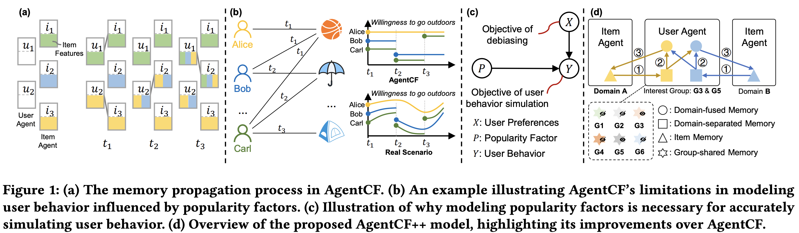
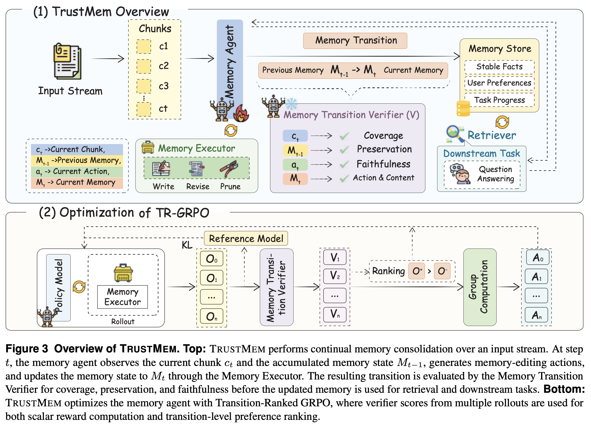
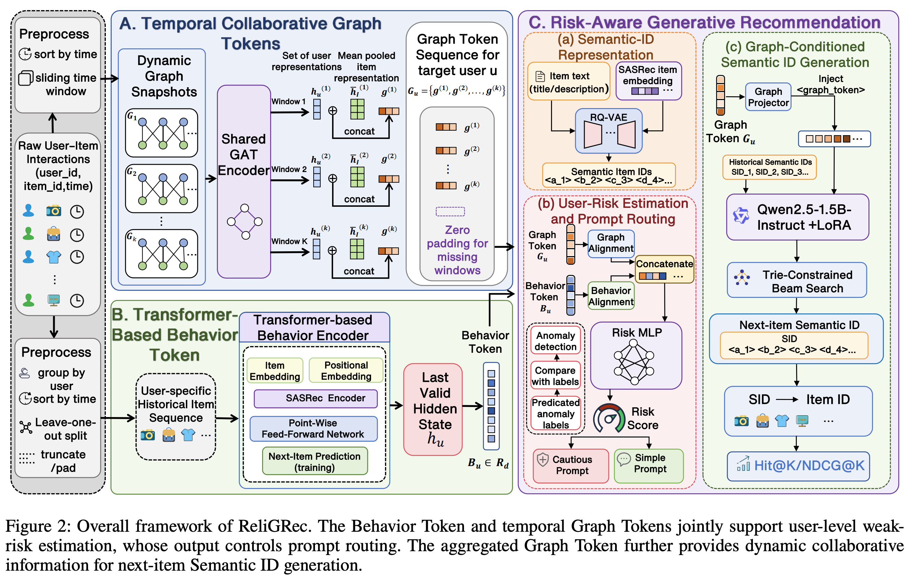
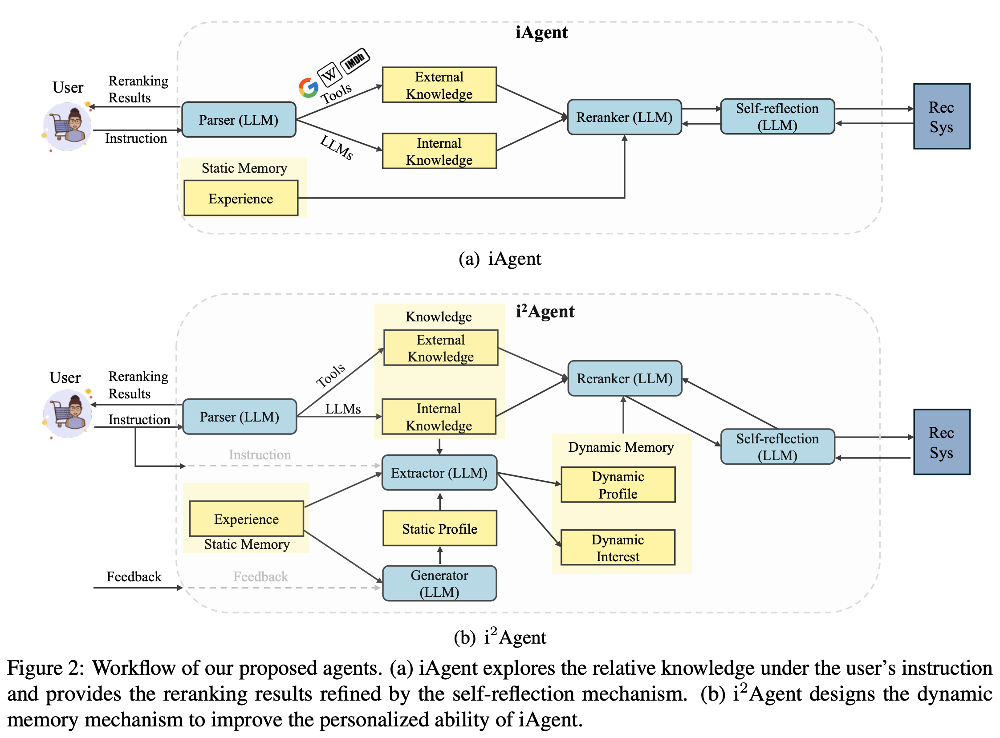

# Paper Index

| Paper | 动机 | 方法 | 重点 | Year | Venue | Link |
|---|---|---|---|---|---|---|
| Agentic Recommender System with Hierarchical Belief-State Memory (MARS) | 平铺式文本 memory 将短期行为与稳定偏好混合，并且没有memory生命周期 | 提出了<u>分层的memory</u>，分别包含最近历史记录，短期/长期兴趣。每次inference的时候会先通过Extract整理memory，同时根据memory进行推荐。 |  | 2026.05 | arXiv | [Paper](https://arxiv.org/abs/2605.14401) · [Notes](<papers/Agentic Recommender System with Hierarchical Belief-State Memory.md>) |
| AMEM4Rec: Leveraging Cross-User Similarity for Memory Evolution in Agentic LLM Recommenders | 现有的工作只制作了user自己的memory，没有考虑到协同的东西 | 创建了一个<u>memory池</u>。让llm能够使用当前user的memory去检索内存池中的shared memory。shared memory创建方法为生成所有的user memory，相似度最高的一对送入llm生成合并后的memory。 |  | 2026.02 | arXiv | [Paper](https://arxiv.org/abs/2602.08837) · [Notes](<papers/AMEM4Rec - Leveraging Cross-User Similarity for Memory Evolution in Agentic LLM Recommenders.md>) |
| When Memory Takes Gradients: Collaborative Vector Memory for Agentic Recommender Systems (CoVeMem) | 如果像MemRec一样去做text memory是很浪费token的 | <u>使用embedding代替text去做memory</u>： 1. 首先用CF训练了一个embedding表征user和item； 2. 把这个embedding对齐到LLM emb的宽度； 3. 继续训练projector+LLM lora（使用了LLM listwise loss） |  | 2026.08 | arXiv | [Paper](https://arxiv.org/abs/2608.26895) · [Notes](<papers/When Memory Takes Gradients - Collaborative Vector Memory for Agentic Recommender Systems.md>) |
| AgenticRec: A Recommendation-Oriented Agentic Framework with Progressive Tool-Integrated Reasoning Optimization | 不训练的LLM agent是没法自己根据情况调用工具的 | ReAct Agent: 使用GRPO去做两阶段训练： 1. 在所有样本生成不同trajectory做GRPO； 2. 在hard-neg sample上生成不同trajectory做GRPO。工具包括：*user info, item info, CF info, 交互统计信息* |  | 2026.03 | arXiv | [Paper](https://arxiv.org/abs/2603.21613) · [Notes](<papers/AgenticRec - A Recommendation-Oriented Agentic Framework with Progressive Tool-Integrated Reasoning Optimization.md>) |
| RRCM: Ranking-Driven Retrieval over Collaborative and Meta Memories for LLM Recommendation | 作者认为如果将所有东西都塞到context会让模型困惑，不如让模型自己从memory挑选 | ReAct Agent: 设置seq memory和item memory，使用GRPO train了一个LLM，让LLM学会怎么调用memory，相当于AgenticRec（2603.21613）的青春版 |  | 2026.05 | arXiv | [Paper](https://arxiv.org/abs/2605.07129) · [Notes](<papers/RRCM - Ranking-Driven Retrieval over Collaborative and Meta Memories for LLM Recommendation.md>) |
| HyperTrace: Hypothesis-Based Preference Tracing for Online LLM Personalization | 模型会把相斥的memory压缩成一段正确但没有信息熵的文本。因此<u>直接用LLM压缩文本不可靠</u> | 模型的memory部分修改为：<u>hypothesis（也就是五个方向不同的memory内容）以及一个权重</u>。 1. 每次让LLM针对每一个hypothesis以及item打分（train只需要对正样本打分） 2. LLM决策应该修改hypothesis还是更新分数。 3. 根据新旧分数更新权重\[P(i^+ \mid h_k,C)=\frac{\exp U(i^+,h_k)}{\sum_{j\in C}\exp U(i_j,h_k)}\]。 | | 2026.09 | Findings of EMNLP 2026 | [Paper](https://arxiv.org/abs/2609.09835) |
| MemRec: Collaborative Memory-Augmented Agentic Recommender System | 1. 需要对模型加协同信息 2. 并且不能把所有协同都送入到LLM prompt中 | train-free的模型。 1. 通过协同图提取出neighbor(包括item和user)。 2. 根据图使用传统方法筛选出top-k neighbor。 3. 把user memory+top-k neighbor输入LLM得出几个层面的解释和分数(facets)。 4. 把facets和其他内容送入LLM进行打分。 | | 2026.01 | ACL2026 | [Paper](https://arxiv.org/abs/2601.08816) · [Notes](<papers/MemRec - Collaborative Memory-Augmented Agentic Recommender System.md>) · [Code](https://github.com/rutgerswiselab/memrec) |
| AgentCF++: Memory-enhanced LLM-based Agents for Popularity-aware Cross-domain Recommendations | 1. 单域信息可能过于孤立 2. 没有利用相似用户之间的群体趋势 | **以下叙述忽略cross-domain** 1. 从多个用户的memory提出tags，提取出emb做kmeans，分group； 2. inference阶段使用user memory + item memory + group memory + candidate得到分数； 3. 使用gt改写user memory，再用user mem改写pos/neg item memory，**group memory里添加本次交互记录**； 4. 定期重新统计user memory的关键词以便新加入和删除分组 | | 2025.02 | SIGIR2025 | [Paper](https://arxiv.org/abs/2502.13843) · [Code](https://github.com/jhliu0807/AgentCF-plus) |
| Useful Memories Become Faulty When Continuously Updated by LLMs | 作者先发现了Memory越更新越差的现象，然后根据这个现象去做了多个实验。 | 背景是llm api based agent。作者做了四组实验： 1. memory持续被更新：<u>模型性能先变好后变坏</u> 2. 找了一组因果性强的数据，在这个数据上做不同的更新：a) 所有序列读取做一次更新；b) 每次一个新交互更新一次数据：<u>更新越少越好</u> 3. 不同更新策略（无memory、summary、group、ungroup、stream）：<u>更新越多越差，把相同的类别聚在一起总结会更好</u> 4. 在一个好的memory上进行stream更新：<u>越更新越差</u> 其他： 1. 作者认为让llm自己选择更新方式比强制总结更好 2. 模型更趋向于在内存上限进行压缩，其他时候进行append | | 2026.05 | arXiv | [Paper](https://arxiv.org/abs/2605.12978) · [Notes](<papers/Useful Memories Become Faulty When Continuously Updated by LLMs.md>) |
| From Lossy to Verified: A Provenance-Aware Tiered Memory for Agents（TierMem） | 现在的两种内存调度策略： 1. 不压缩memory（贵） 2. 压缩memory（差） 作者结合了一下两种内存调度策略 | 背景：LLM api based agent。作者提出了2-tiers内存。以及**<u>创建一个router判断什么时候要用tier-2的memory</u>** 1. tier-2: 先把原始对话按照1000token切，每一个为一个memory 2. tier-1: tier-2的每一个memory都让llm进行压缩，再emb。与tier-2一一对应 3. 一个router | | 2026.05 | arXiv | [Paper](https://arxiv.org/abs/2602.17913) · [Notes](<papers/From Lossy to Verified A Provenance-Aware Tiered Memory for Agents.md>) · [Code](https://github.com/FreedomIntelligence/Tiermem) |
| TRUSTMEM: Learning Trustworthy Memory Consolidation for LLM Agents with Long-Term Memory | 现有 LLM agent 的 memory 机制最大的问题是<u>“memory 会在不断更新过程中被污染导致错误长期累积”</u>。 | 背景：LLM api based agent。就是memory+query+candidate去决策。 train的时候就是用正样本+旧memory**<u>改写</u>**新memory。然后<u>通过一个**verify**去判断新的memory是否包含旧的memory的信息+新的正样本的信息</u>。使用GRPO训练**<u>memory的改写器</u>**   | | 2026.06 | arXiv | [Paper](https://arxiv.org/abs/2606.25161) |
| ReliGRec: Reliability-Oriented LLM-Based Generative Recommendation via User-Risk-Aware Prompt Routing | 用户的行为有时候会出现和其他用户行为不一致的现象，并且用户的兴趣会随着时间变化。因此需要对时间窗口去做切分，得到不同时间段用户的兴趣。 | 背景：SID + Graph + LLM Rec 1. 根据用户历史生成用户兴趣向量 2. 根据不同时间窗口的CF信息生成不同时间段用户兴趣向量 3. 根据以上两个信息生成一个分数选择Prompt 4. history SID + graph的emb + Prompt 做 inference | | 2026.09 | arXiv | [Paper](https://arxiv.org/abs/2609.16560) · [Notes](papers/ReliGRec-Reliability-Oriented-LLM-Based-Generative-Recommendation-via-User-Risk-Aware-Prompt-Routing.md) |
| AgentCF: Collaborative Learning with Autonomous Language Agents for Recommender Systems | 现有 LLM agent 主要模拟语言行为，且仅靠单个 user 的历史无法建模推荐中的 collaborative signal。 | 背景：train-free的Agentic Rec 1. 使用user/item memory存储用户/物品特征 2. 失败时能通过负样本总结用户偏好存入u mem。 3. u mem被更新之后可以用于更新i mem 4. inference使用base+**retrieval**的方式提高协同信息 | | 2023.10 | WWW 24 | [Paper](https://arxiv.org/abs/2310.09233) · [Notes](<papers/AgentCF - Collaborative Learning with Autonomous Language Agents for Recommender Systems.md>) · [Code](https://github.com/RUCAIBox/AgentCF) |
| iAgent: LLM Agent as a Shield between User and Recommender Systems | 不是“现有 memory 更新不好”，而是“现有推荐由平台主导，缺少真正站在单个用户侧、理解当前显式需求并根据个人反馈自适应的 agent”。（感觉没什么说服力） | 背景：train-free的Agentic Rec + google search tools 1. 根据用户输入改写成陈述，llm判断是否需要外部search 2. 根据prompt + memory (如果有) + pos + 1-neg + search结果进行ranking。（inference是9个neg） 3. 如果有memory，使用旧memory + candidate + pos + neg + reflection进行memory改写。 | | 2025.02 | ACL 2025 Findings | [Paper](https://arxiv.org/abs/2502.14662) · [Notes](<papers/iAgent - LLM Agent as a Shield between User and Recommender Systems.md>) · [Code](https://github.com/WujiangXu/iAgent) |
