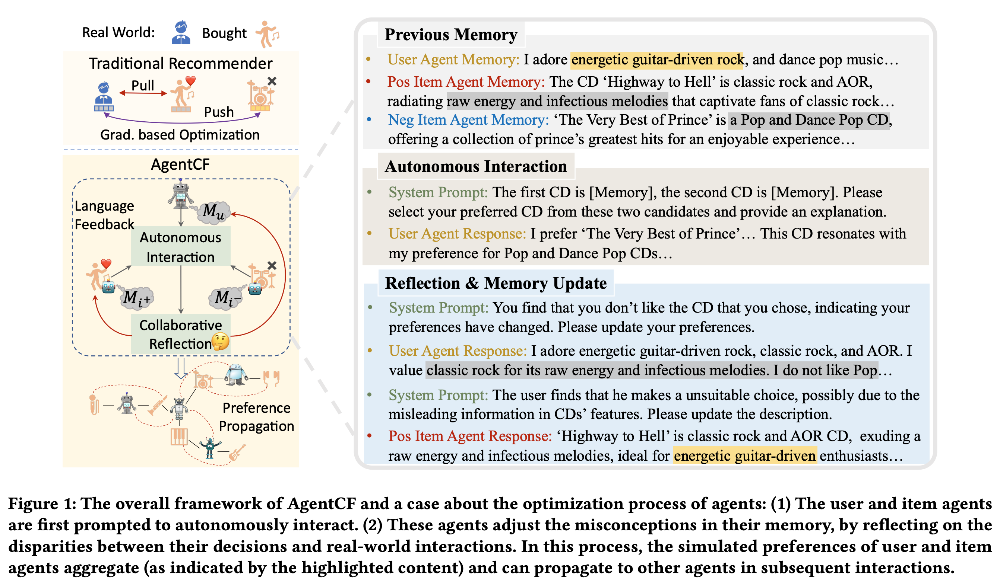
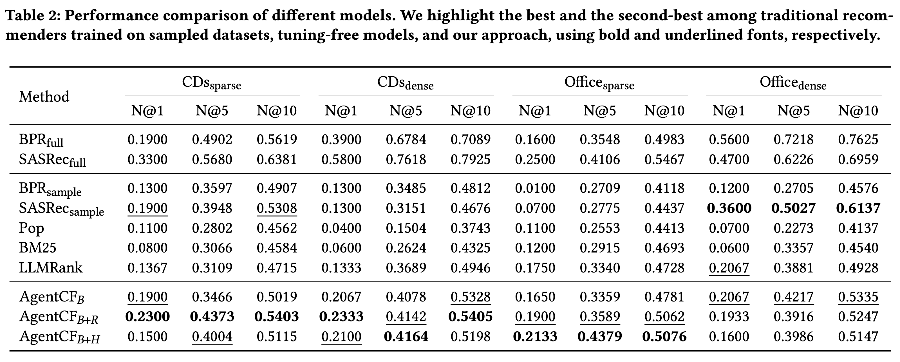

# AgentCF: Collaborative Learning with Autonomous Language Agents for Recommender Systems

- **Year:** 2023
- **Venue:** WWW 2024
- **Paper:** https://arxiv.org/abs/2310.09233
- **Code:** https://github.com/RUCAIBox/AgentCF

## TLDR

最初始的AgentRec的文章。每个user和item维护一个memory。每次history都会更新memory。



## Abstract

近年来，由于大语言模型（LLM）具备出色的决策能力，越来越多的研究开始使用 LLM 驱动的智能体来模拟真实的人类。然而，现有研究主要集中在模拟人类的对话行为。对于推荐系统中的商品点击等非语言行为，虽然这些行为能够隐式反映用户偏好，并有助于用户建模，但目前仍缺乏深入研究。主要原因在于：语言建模与行为建模之间存在差距，同时 LLM 对用户与物品之间的关系缺乏理解。

为了解决这一问题，我们提出 **AgentCF**，通过基于智能体的协同过滤来模拟推荐系统中的用户-物品交互。与以往只将用户视为智能体的方法不同，我们同时将**用户和物品都建模为智能体**，并设计了一种协同学习方法共同优化两类智能体。

具体而言，在每一个时间步，首先让用户智能体和物品智能体自主进行交互；随后，将智能体做出的决策与真实世界的交互记录进行比较。根据二者之间的差异，让用户和物品智能体进行反思，并共同调整之前错误的模拟，从而逐渐学习双方之间的关系。

经过优化后的智能体，还能够在后续交互中把自己的偏好信息传播给其他智能体，从而隐式实现协同过滤。最终，AgentCF 能够形成包括用户-物品、用户-用户、物品-物品以及群体交互在内的多种交互模式。实验表明，这些智能体能够表现出类似真实用户的个性化行为。


## Motivation

现有 LLM agent 主要模拟语言行为，且仅靠单个 user 的历史无法建模推荐中的 collaborative signal。AgentCF 因此同时构建 user/item agents，并通过真实 user-item interaction 共同更新双方 memory，使 preference 能沿 user-item graph 传播。


## Method

Train-free的Agentic Rec。

**User Memory**

1. 当前最新的一段用户偏好描述：\[M_u^s=\text{short-term memory}\]

2. 上述描述的所有snapshot构成的数组：\[M_u^l=\text{long-term memory}\]


**Item Memory**

一开始是 title/category 等属性，以后不断把“**什么样的用户喜欢这个 item**”写进去。


### Train阶段

$$
(u,i^+) \rightarrow \text{sample }i^- \rightarrow \text{LLM二选一} \rightarrow \begin{cases} \text{选错：Reflection Update}\\ \text{选对：Correct Update} \end{cases}
$$

对于每个history，采样一个负样本。让LLM从 `i^+` 和 `i^-` 里选一个（没有打分），并说明为什么。


- **预测成功**

```
old user memory
+ pos item
+ neg item
+ reason
        ↓
更新 User
        ↓
new user memory
+ old pos item memory
+ old neg item memory
        ↓
更新 positive Item
```


- 预测失败

首先更新 **user memory**：\[M_u^{t+1} = LLM( M_u^t,\, M_{i^+}^t,\, M_{i^-}^t,\, r,\, \text{GT: 实际应该选 }i^+ )\]

这里 prompt 会明确告诉它：你刚才根据当前 preference 选择了 \[i^-\]，但真实用户实际上喜欢 \[i^+\]。所以你刚才的 preference 判断有问题，请分析错误并修改自己的 profile。

**再更新 positive item**：\[M_{i^+}^{t+1} = LLM( M_{i^+}^{t}, M_{i^-}^{t}, M_u^{t+1}, r, \text{GT} )\]

然后**拿更新后的 memory 再做一次 pairwise prediction**：\[(M_u^{t+1},M_{i^+}^{t+1},M_{i^-}^{t}) \rightarrow \text{再次选 } i^+ \text{ or } i^-\]。如果还错，可以继续 reflection，直到达到最大 round；官方默认 `all_update_rounds=2`。


## Inference

作者在inference用了三种方法，分别是base，base+retrieval，base+full history

### base

1pos+9neg，让LLM listwise。

### retrieval

指的是把item的candidate拼起来做embedding。把每一条历史 user memory 也 embedding。比较top-1的sim。

### full history

直接把所有历史memory都塞到prompt里。


## Experiments



所以最后的收益其实还是retrieval来的。
