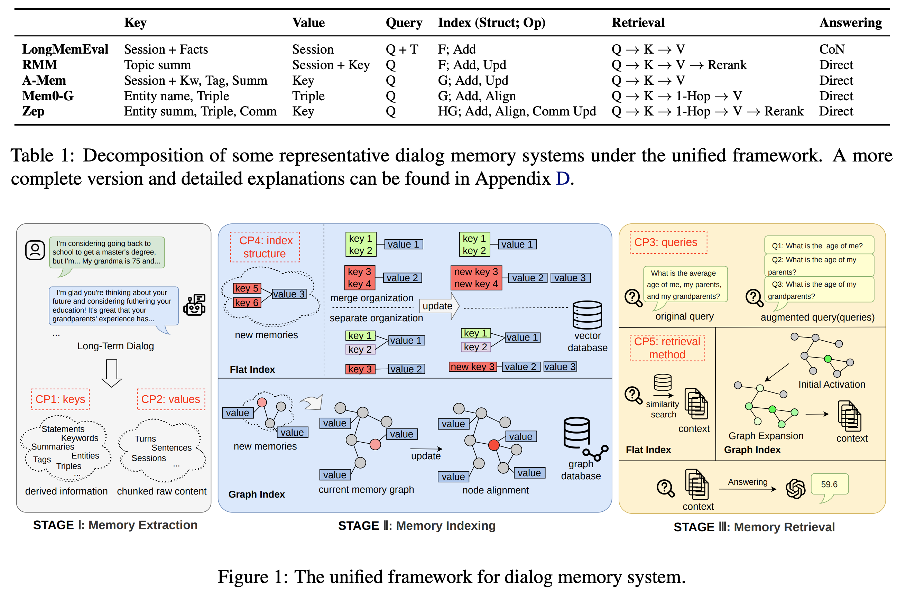

# Does Memory Need Graphs? A Unified Framework and Empirical Analysis for Long-Term Dialog Memory

- Year: 2026
- Venue: ACL 2026 (Long Paper) 
- Paper: https://aclanthology.org/2026.acl-long.1232/
- Code: https://github.com/AvatarMemory/UnifiedMem

## TLDR

文章的背景是*历史对话 QA*，任务是从历史的Session中记录用户的需求，以便后续检索。

**一个User有一个Memory Bank，内部有多条Memory，一条Memory对应一个Session，具体的Memory构成是(K, V)。**

分析了一下K的不同构成，K的更新方法，KV组成graph边的连接方式，计算相似度的方式，以及一个最终对比。

但是他分析的中间结果都是性能指标，而不是可视化的分布。



## Abstract

受图结构在检索增强生成（RAG）领域取得成功，以及人类记忆具有联想性这一特点的启发，图结构正越来越广泛地应用于对话记忆系统。

然而，现有研究对于图结构有效性的实证结论并不一致，因此尚不清楚究竟哪些设计选择真正重要。

在本文中，我们从实验和系统设计的角度，对长期对话记忆架构展开分析。

我们提出了一个统一框架（Unified Framework），将对话记忆系统分解为若干核心组件，同时支持基于图结构和非图结构的两类方法。

基于这一框架，我们在 LongMemEval 和 HaluMem 两个基准上开展了受控的、分阶段的实验（Controlled, Stage-wise Experiments），比较了记忆表示（Memory Representation）、记忆组织（Memory Organization）、记忆维护（Memory Maintenance），以及索引（Indexing）和检索（Retrieval）等方面的常见设计选择。

实验结果表明，底层实现细节对系统性能具有显著影响，而这些细节在以往研究中往往没有得到充分说明。

此外，我们识别出了一组稳定、可靠且性能较强的基线方法（Strong Baselines），以支持公平的方法比较和实际系统部署。


## Method

本文是一个分析驱动的文章。通过一些实验发现当前图在memory上的一些问题。

作者并没有跑所有的模型进行比较，而是<u>先**自定义了memory是由Pair对构成的**</u>，之后<u>说明了不同的模型能够被归类为不同的部分中不同的方法</u>。<u>再进行单变量的比较</u>。


### 统一架构

作者把Memory统一成：\[\mathcal M=\langle K,V,Q,I,R,A\rangle\]。其中：

| 变量  | 含义                             |
| ----- | -------------------------------- |
| \(K\) | Key：用于检索的 Memory Unit      |
| \(V\) | Value：最终提供给 LLM 的证据信息 |
| \(Q\) | Query：当前问题                  |
| \(I\) | Index：Flat Index 或 Graph Index |
| \(R\) | Retrieval：如何找到相关 Memory   |
| \(A\) | Answering：如何使用 Memory 回答  |

大概意思是Memory可以从K检索到V，K是一个索引。实际情况中K可以等于V，也可以是V的浓缩。

\[\underbrace{I}_{\text{怎么组织}} \rightarrow \underbrace{R}_{\text{怎么找}} \rightarrow \underbrace{A}_{\text{怎么用}}\]


作者定义了Memory的四种信息：

| 符号    | 类型               | 含义         |
| ------- | ------------------ | ------------ |
| Session | Raw Dialogue       | 原始对话     |
| S       | Summary            | 对话总结     |
| F       | Factual Statements | 提取出的事实 |
| K       | Keywords           | 关键词       |

例如：

```
用户：我最近开始学爵士钢琴，之前主要弹流行音乐。我特别喜欢 Funk 的节奏。

S：用户喜欢钢琴，目前正从流行音乐转向爵士。
F：用户正在学习爵士钢琴；以前主要弹流行音乐；喜欢 Funk 节奏。
K：Jazz、Piano、Pop、Funk。
```

这三个都是从原始对话中使用不同的Prompt通过大模型得到的。

**<u>这些信息被用来构建K和V</u>**。


### 实验一：Key Selection - Memory 应该提取和组织哪些信息

目的：判断不同的Memory检索方式对结果的影响。


实验：修改了不同K的构成

| Key Design      | Recall@5   | Recall@10  |
| --------------- | ---------- | ---------- |
| Session         | 0.7112     | 0.8043     |
| Session,S,F,K   | 0.7327     | 0.8521     |
| [Session,S,F,K] | 0.7184     | 0.8210     |
| Session,[S,F,K] | **0.7685** | **0.8592** |
| S,F,K           | 0.6921     | 0.8091     |
| [S,F,K]         | 0.7064     | 0.8138     |

其中逗号代表对于一个Query，转换成Emb之后和每个key都计算相似度再取平均。中括号代表先concat，再取Emb。

实验部分的Value用了原始的Session。


### 实验二：Memory Operations - Memory 应该如何更新

目的：判断不同Update对Memory（主要是key）的影响。


作者定义了信息几种更新方法。

| Operation | 含义                            |
| --------- | ------------------------------- |
| Add       | 新信息直接作为一条 Memory 加入  |
| Update    | 用新信息修改已有 Memory         |
| Noop      | 不做任何修改                    |
| Delete    | 删除已有 Memory（本实验不考虑） |

更新方法是<u>从Memory Bank检索出Top-5的Memory，然后用新的Session去更新旧的`S,F,K`。</u>本实验的 <u>**Value = K**</u>。


指标：

| 指标        | 衡量什么                           | 0.8 大概意味着什么                   |
| ----------- | ---------------------------------- | ------------------------------------ |
| Mem-R       | 应该记住的信息，有多少被完整保留？ | 约 80% 的目标记忆点被完整覆盖        |
| Mem-P       | 提取的目标记忆内容是否准确？       | 目标记忆内容的平均准确性得分约为 0.8 |
| MemUpdate-C | 应该更新的事实，有多少被正确更新？ | 约 80% 的目标更新被完整正确地体现    |
| QA-C        | 最终回答问题的正确率               | 约 80% 的问题回答正确                |

这些指标的gt都是在原始数据集上就构建出来的。把update的memory拆成多个point，查看覆盖率多少。

实验：

| Key     | Operation       | Mem-R ↑ | Mem-P ↑ | MemUpdate-C ↑ | QA-C ↑     |
| ------- | --------------- | ------- | ------- | ------------- | ---------- |
| S,F,K   | Add             | 0.7332  | 0.9360  | —             | 0.2815     |
| S,F,K   | Add/Update/Noop | 0.8069  | 0.8829  | 0.1416        | 0.5134     |
| [S,F,K] | Add             | 0.7332  | 0.9360  | —             | **0.4785** |
| [S,F,K] | Add/Update/Noop | 0.8057  | 0.8846  | **0.2207**    | **0.5861** |

> Mem-R 是 Memory Extraction Recall；Mem-P 是 Target Memory Extraction Precision；MemUpdate-C 是更新操作正确率；QA-C 是最终问答正确率。


结论：

1. `[S,F,K]` 优于 `S,F,K`
2. Update/Noop 能提升最终 QA 表现
3. Update/Noop 可能错误修改 Memory

### 实验三：Graph Construction - Memory Graph 应该如何构建

主要有几种Graph方法：

| 方法      | 节点（Node）         | 边（Edge）                 | 人能读懂的                                                   |
| --------- | -------------------- | -------------------------- | ------------------------------------------------------------ |
| Flat      | Session 的 `[S,F,K]` | 无                         | **最普通的Mem，和Graph没关系**                               |
| SimGraph  | Session 的 `[S,F,K]` | Memory 之间的语义关联      | 先检索 Top-5 相似 Memory，再由 LLM 判断是否连边。**把相似的Mem连起来，图的节点意义相同** |
| KnowGraph | 实体（Entity）       | 三元组中的关系（Relation） | 从对话提取 `(Subject, Predicate, Object)`，建立知识图。**二分图，subject和object，边是关系** |
| DescGraph | 实体 + 自然语言描述  | 实体之间的关系             | 在 KnowGraph 基础上增加 Entity Description，保留更丰富的事件和上下文信息 |

> 实验控制： 三种 Graph 使用相同的检索流程 `Q → K → 1-Hop → V`，主要改变 Graph Schema；Flat `[S,F,K]` 作为非图基线。该实验只评价 Retrieval，没有比较 QA Accuracy。

Graph的逻辑是检索到top的*几个*key，拿到这些原始key的1-hop的所有key对应的value（raw session）。再把这些value排序拿到topk输入到llm。


实验：

| Graph Design   | LME-S R@5  | LME-S R@10 | LME-M R@5  | LME-M R@10 |
| -------------- | ---------- | ---------- | ---------- | ---------- |
| Flat `[S,F,K]` | 0.9045     | 0.9642     | 0.7064     | 0.8138     |
| SimGraph       | 0.8424     | 0.9498     | 0.6043     | 0.7766     |
| KnowGraph      | 0.9116     | 0.9665     | 0.6610     | 0.7828     |
| DescGraph      | **0.9331** | **0.9713** | **0.7661** | **0.8735** |


结论：Graph 并不一定比 Flat Memory 更好，但为 Graph 节点增加自然语言 Description，可以显著改善 Retrieval。**那其实不还是增加了信息导致结果增加了吗**

### 实验四：Graph Retrieval - Graph 应该如何检索

有两个子实验

实验一：retrieval的时候比较sim该怎么比？key侧是只用 <u>item</u> 本身还是 <u>concat(user, item, behavior)</u> 的emb去做相似度检索。

| Activation | Recall@5 | Recall@10 | NDCG@5 | NDCG@10 |
| ---------- | -------- | --------- | ------ | ------- |
| item       | 0.9642   | 0.9905    | 0.9599 | 0.9648  |
| Triples    | 0.9403   | 0.9809    | 0.9363 | 0.9460  |


实验二：检测1-hop有没有用

| 方法               | 怎么排                                                       |
| ------------------ | ------------------------------------------------------------ |
| Score_s            | 直接计算 Query 与 V1、V2、V3 原文的相似度                    |
| Score_e            | 看 V1、V2、V3 分别是通过哪个 Key 找到的，按 Key 的检索排名排序 |
| (Score_e, Score_g) | 先按照 Score_e 排名，如果相同，再根据 Graph 关联数量区分     |

实验：

| Reranking          | No Expansion R@5 / R@10 | 1-Hop R@5 / R@10 |
| ------------------ | ----------------------- | ---------------- |
| Score_s            | 0.9546 / 0.9904         | 0.8615 / 0.9618  |
| Score_e            | 0.9642 / 0.9904         | 0.9594 / 0.9643  |
| (Score_e, Score_g) | 0.9642 / 0.9904         | 0.9642 / 0.9928  |


### End-to-end Evaluation：组合后的 Flat 和 Graph 哪个更好

作者给 Flat 和 Graph 分别选择一套配置，再将两套系统完整跑一遍。

| 指标            | Flat   | Graph  | 谁更好 |
| --------------- | ------ | ------ | ------ |
| Retrieval R@10  | 0.8353 | 0.9307 | Graph  |
| QA（V=Session） | 0.638  | 0.754  | Graph  |
| QA（V=Key）     | 0.620  | 0.592  | Flat   |

结论一：Graph 检索更好。

结论二：只使用 Memory Key 回答时，Graph 反而更差。


## 后记

他的实验是定义memory的组成，然后根据不同组成找到当前关于这一部分的方法，对于不同的方法去做分析实验。那么我下一步其实也是具体分析这三部分具体可以怎么拆解，以及拆解后主要方法是什么，然后使用同一个模型baserec，只修改这一部分去做实验最后分析。

但是也有问题，他的分析都是基于中间指标/最终指标的表，没有一些真正中间结果**机制**分析。


