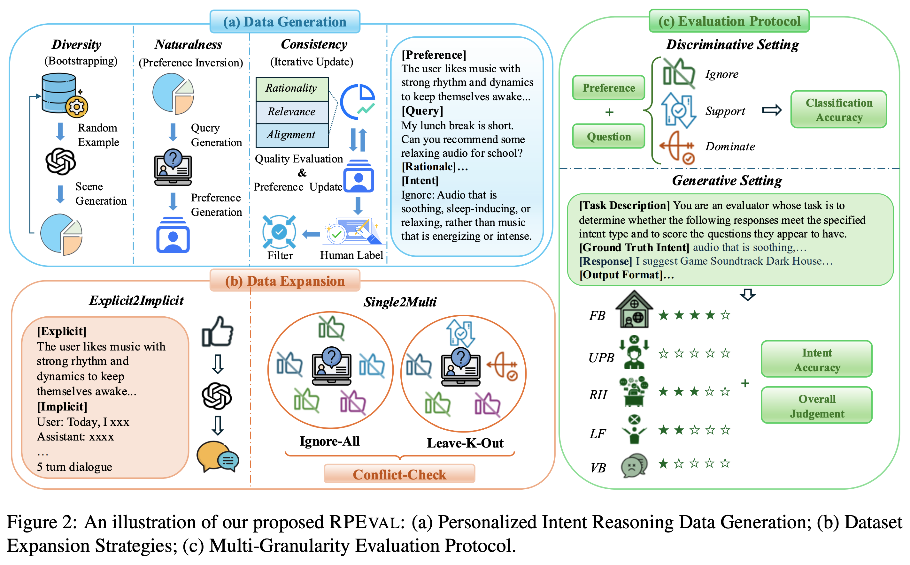
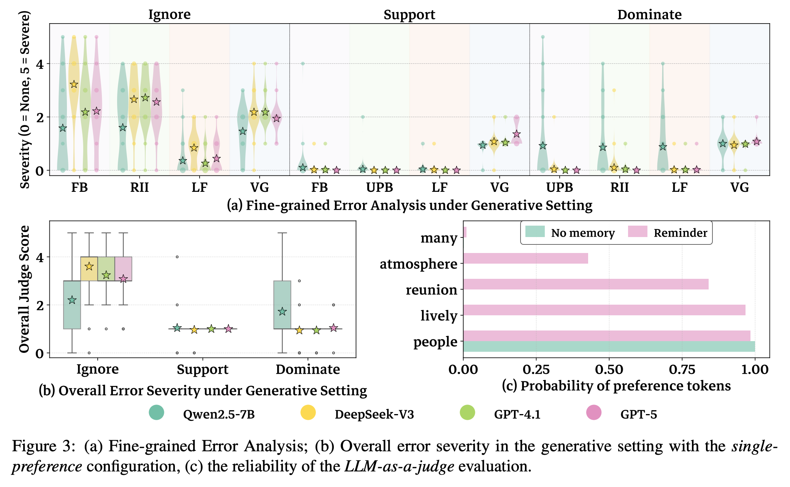

# How Does Personalized Memory Shape LLM Behavior? Benchmarking Rational Preference Utilization in Personalized Assistants

- **Year:** 2026
- **Venue:** NeurIPS 2026 (Datasets and Benchmarks Track)
- **Paper:** https://arxiv.org/abs/2601.16621
- **Code:** https://github.com/XueyangFeng/RPEval

## TLDR

Agent Memory主要分为三部分：怎么保存，怎么更新，怎么被使用。作者主要分析**被使用**这部分的问题。分析的结果是LLM不擅长拒绝无关 Memory，只要Memory出现，不管对Query是否有用，结果都会生成和Memory相关的东西。作者为此提出了一个反思模块决策Memory和Query的相关性，最终提升了性能。

## Abstract

近年来，基于大语言模型（LLM）的智能助手开始引入记忆机制，记录用户的个人偏好，以生成更加个性化、更符合用户需求的回答。然而，与当前任务无关的个性化记忆经常被引入上下文，从而干扰 LLM 对用户真实意图的理解。

为了系统研究个性化带来的正面与负面影响，作者提出了 RPEval，这是一个包含个性化意图推理数据集和多粒度评测协议的 Benchmark。

通过 RPEval，作者发现现有 LLM 普遍存在**非理性个性化（Irrational Personalization）**现象，并进一步分析了不同的错误模式及其对用户体验的负面影响。

针对这一问题，作者提出了 RP-Reasoner，将 Memory Utilization 视为一个**语用推理（Pragmatic Reasoning）**过程，使模型能够根据用户当前的真实意图，有选择地使用个性化信息。

实验结果表明，RP-Reasoner 在 RPEval 上显著优于精心设计的基线方法，并解决了某大型商业个性化助手中观察到的 80% 的问题案例，表明语用推理有望有效缓解非理性个性化问题。

## Motivation

现有个性化助手过度强调利用 Memory，却忽略了 Memory 可能对当前任务产生负面影响。

## Method

这是一个Analysis-driven的实验。主要是关注于memory在被llm**<u>使用</u>**的时候的一些问题。

作者首先做了分析实验，判断当前的一些方法的问题，之后分析问题具体出在哪里，然后修改了那部分的策略提出一个解决方法。

### 实验一：证明LLM没法判断Memory是否和Query相关

输入：

> Memory：用户喜欢节奏强烈的音乐。
>
> Query：推荐一些午休时听的放松音乐。

让 LLM 判断这条 Memory 应该：

- Ignore：不使用
- Support：辅助参考
- Dominate：主导回答

正确答案是 Ignore。

实验结果：

| 模型        | Ignore | Support | Dominate |
| ----------- | ------ | ------- | -------- |
| Human       | 86%    | 100%    | 98%      |
| Qwen2.5-7B  | 6%     | 84%     | 24%      |
| DeepSeek-V3 | 38%    | 78%     | 82%      |
| GPT-4.1     | 28%    | 34%     | 96%      |
| GPT-5       | 12%    | 58%     | 82%      |

现象：

1. 模型没法判断Memory是否有用
2. 模型不是不擅长使用 Memory，而是不擅长忽略 Memory

### 实验二：证明LLM无法判断多条Memory中哪个对Query有用

gnore-All（IA）：给 3–8 条完全无关的 Memory，正确做法是全部忽略。

Leave-K-Out（LKO）：给多条 Memory，其中 1–3 条相关，其余不相关，正确做法是识别出和 Query 相关 Memory。

作者使用两种 Accuracy：

- Micro：逐条 Memory 判断，计算正确比例。
- Macro：一组 Memory 必须全部判断正确，才算正确。

**结果：**

Macro Accuracy：所有 Memory 都判断正确才算对

| 模型        | IA   | LKO  | ALL  |
| ----------- | ---- | ---- | ---- |
| Human       | 75%  | 71%  | 73%  |
| Qwen2.5-7B  | 12%  | 2%   | 6%   |
| DeepSeek-V3 | 5%   | 7%   | 6%   |
| GPT-4.1     | 8%   | 4%   | 6%   |
| GPT-5       | 0%   | 3%   | 2%   |

Micro Accuracy：逐条 Memory 计算正确率

| 模型        | IA   | LKO  | ALL  |
| ----------- | ---- | ---- | ---- |
| Human       | 94%  | 93%  | 93%  |
| Qwen2.5-7B  | 45%  | 36%  | 39%  |
| DeepSeek-V3 | 57%  | 56%  | 56%  |
| GPT-4.1     | 52%  | 48%  | 49%  |
| GPT-5       | 26%  | 46%  | 39%  |

### 实验三：判断能力不足，会不会真的影响最终回答

作者将Memory和Query的匹配错误划分为了以下几种方式：

| 正确策略 | 实际使用方式 | 错误                                               |
| -------- | ------------ | -------------------------------------------------- |
| Ignore   | Support      | RII：不必要地混入个性化内容                        |
| Ignore   | Dominate     | FB：过度依赖偏好                                   |
| Support  | Ignore       | UPB：个性化不足                                    |
| Support  | Dominate     | FB：过度个性化                                     |
| Dominate | Ignore       | UPB：个性化不足                                    |
| Dominate | Support      | RII：偏好未充分主导回答                            |
| x        | x            | LF（Low Feasibility）：建议不合理或不可行。        |
| x        | x            | VG（Verbose Generation）：内容冗余、反复复述偏好。 |

实验结果：

在Ignore下LLM的各种问题最多，但是在Support和Dominate下基本没问题。

结论：

1. LLM 的主要问题不是不会使用 Memory，而是容易过度使用本应被忽略的 Memory。

### 实验四：Memory 和当前问题没关系，仍然会影响 LLM 生成的内容

**例子：**

Memory：

> 用户喜欢热闹、喜欢聚会、喜欢很多人待在一起。

现在用户问：

> 给我的猫推荐一个生日礼物。

看一下<u>加入这条无关 Memory 后，模型会不会更容易生成「热闹」「聚会」「很多人」之类的词？</u>

实验在Fig3的c部分。

结论：

> LLM 会受到上下文中 Memory 内容的吸引，即使这些 Memory 对当前任务并不相关。

这就叫 Attraction Bias。

### 基于实验作者提出了方法

LLM 容易被 Memory 干扰，那么就不能简单地把 Memory 和 Query 拼接起来直接回答。

从 \[\text{Memory + Query}\rightarrow \text{Answer}\] 修改成 \[\text{Memory + Query} \rightarrow \boxed{\text{Intent Reasoning}} \rightarrow\text{Answer}\] 。**先推断用户当前究竟想干什么，再决定该不该使用 Memory。**

| Method      | Macro Acc ↑ | Micro Acc ↑ | Error Severity ↓ |
| ----------- | ----------- | ----------- | ---------------- |
| Vanilla     | 1.3%        | 40.0%       | 3.533            |
| Reminder    | 1.3%        | 39.5%       | 3.580            |
| CoT         | 6.7%        | 39.5%       | 3.487            |
| RP-Reasoner | 24.0%       | 52.2%       | 2.493            |
