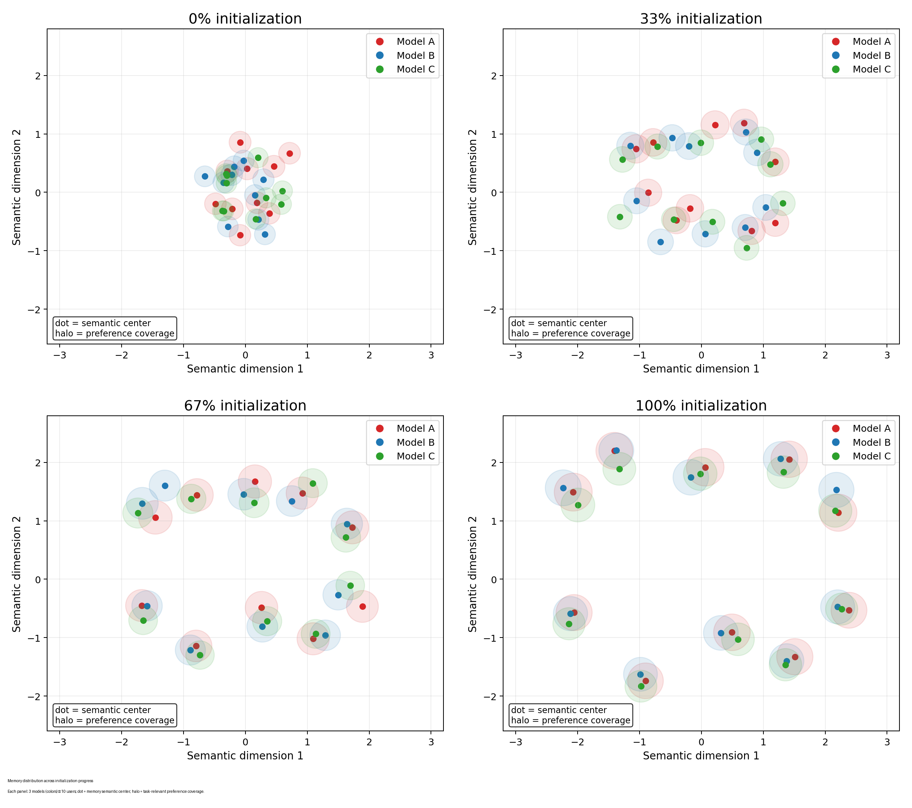
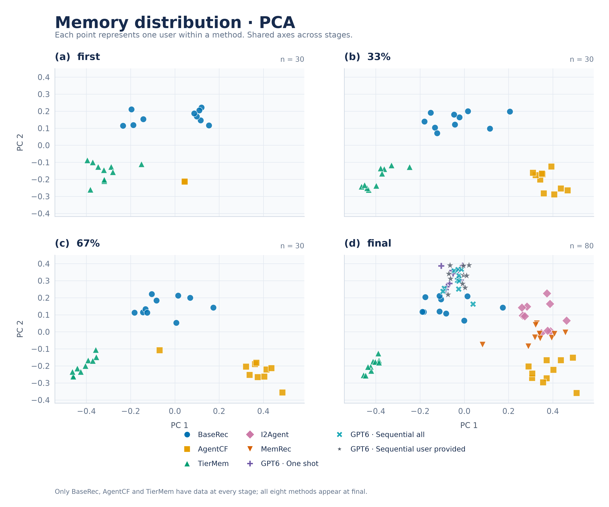
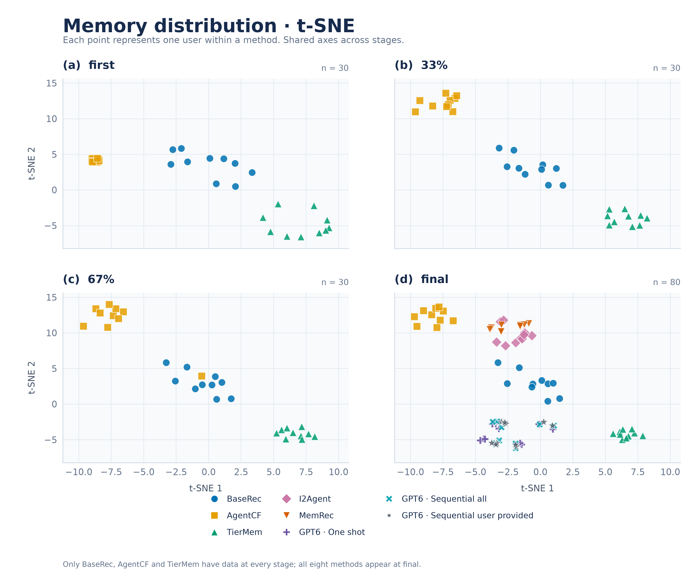
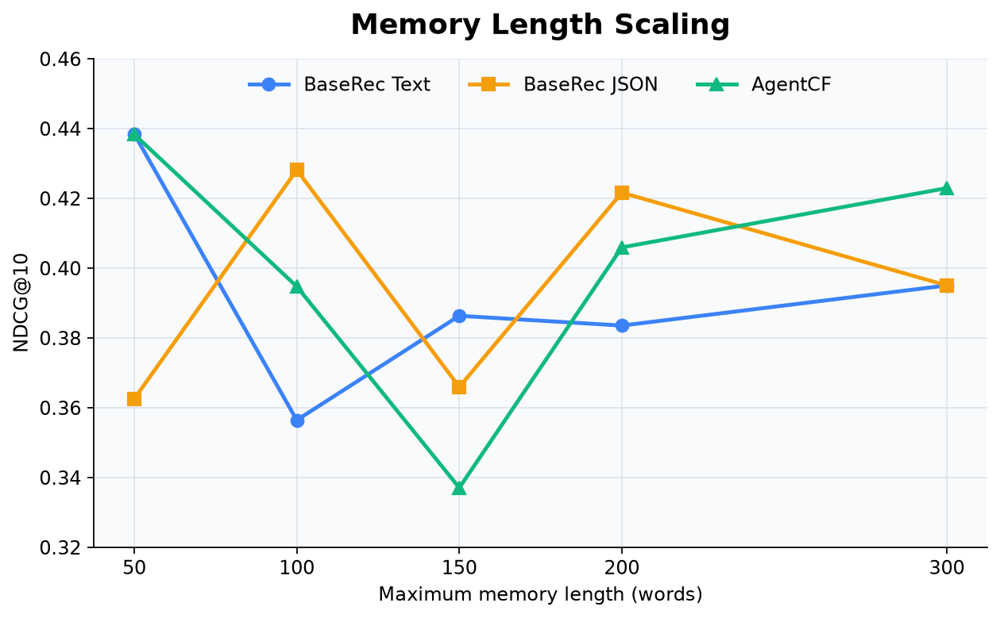

# 之前的思路

## Targets

1. 定义内存窄化
2. 证明现在性能不足时和内存窄化相关的
3. 找到窄化的原因
4. 想一个方法让内存不窄化并且提高性能

感觉有点像文本压缩：如何在保留信息的情况下把文本压缩的最狠。

## 内存窄化是什么

**Narrowing**：针对于单个用户，其 memory 能表达的 task-relevant preference support 越来越小。

**Homogenization**：针对于全体用户，所有的memory表达都更加宽泛而同质化，因此都相似。

想做的图大概是这样：分不同的初始化阶段分别作图。每个图包含若干颜色代表若干模型，降维之后一个点代表某个模型下的这个user，每个user还包含一个halo代表Narrowing程度。

窄化代表图里的点越来越集中，圈越来越大。

## Experiments

背景：从Memrec的Yelp数据集sample出10个user。按照sasrec对test的全库排名分为5档：`Top10`、`11-20`、`21-50`、`51-100`、`>1000`。每档2个user。其中大部分user长度都在80-100之间。使用原始的title+description作为item的信息。

### 测试现有工作的性能

模型：

BaseRec为每个user设立一个memory，每次迭代使用正样本更新user mem，item侧没有memory。

AgentCF为u/i都有memory，更新时使用sample negative，输入正+负+old user mem，每次迭代更新二者。

**其中MemRec没有使用完整数据导致无法体现出CF的优势**。

结果：

| Memory                                   | NDCG@1 | NDCG@3 | NDCG@5 | NDCG@10 | MRR    | Final-Mem 平均Token             |
| ---------------------------------------- | ------ | ------ | ------ | ------- | ------ | ------------------------------- |
| BaseRec（Qwen3-8B）                      | 0.0000 | 0.1500 | 0.1563 | 0.3720  | 0.1912 | 70（硬截断180words）            |
| AgentCF（Qwen3-8B）                      | 0.1000 | 0.1500 | 0.1500 | 0.4098  | 0.2411 | 86（软截断u180, i50words）      |
| 把AgentCF所有的历史memory扔给GPT6总结    | 0.1000 | 0.1631 | 0.1631 | 0.4190  | 0.2538 | 89                              |
| 把所有的item seq扔给GPT6总结             | 0.1000 | 0.1631 | 0.1631 | 0.4085  | 0.2436 | 96                              |
| 按照自回归的方法让GPT6每次迭代产生memory | 0.1000 | 0.1631 | 0.1631 | 0.4114  | 0.2464 | 120                             |
| BaseRec+AgentCF（Qwen3-8B）              | 0.1000 | 0.1631 | 0.2018 | 0.4239  | 0.2590 | 156                             |
| TierMem（Qwen3-8B）                      | 0.0000 | 0.0631 | 0.1062 | 0.3532  | 0.1706 | 854（硬截断10000 tokens）       |
| i2Agent（Qwen3-8B）                      | 0.2000 | 0.3893 | 0.4280 | 0.5519  | 0.4179 | **8883**（无mem截断，拼接时有） |
| MemRec（Qwen3-8B）                       | 0.0000 | 0.2262 | 0.2693 | 0.4265  | 0.2538 | 128（最终mem无截断，过程有）    |

结论：

1. 模型能力不是当前的性能上限（三个GPT6性能也一般）
2. 新方法未必有老方法好
3. 现在的模型只注重于设计Memory，但是做了不公平的比较（没有考虑mem长度和更新次数以及时间）

细节：

| User | SASRec bucket | BaseRec | AgentCF | GPT6_历史Memory | GPT6_历史item | GPT-6_迭代Memory | BaseRec+AgentCF | TierMem | I2Agent | MemRec | Avg  |
| ---- | ------------- | ------- | ------- | --------------- | ------------- | ---------------- | --------------- | ------- | ------- | ------ | ---- |
| 623  | SASRec Top-10 | 3       | 1       | 1               | 10            | 6                | 1               | 6       | 9       | 3      | 4.4  |
| 2857 | SASRec Top-10 | 2       | 3       | 2               | 2             | 2                | 2               | 2       | 2       | 3      | 2.2  |
| 2554 | SASRec 11-20  | 10      | 8       | 8               | 9             | 9                | 8               | 10      | 10      | 8      | 8.9  |
| 1622 | SASRec 11-20  | 9       | 9       | 10              | 9             | 10               | 7               | 9       | 7       | 9      | 8.8  |
| 403  | SASRec 21-50  | 8       | 7       | 7               | 1             | 8                | 7               | 9       | 1       | 2      | 5.6  |
| 19   | SASRec 21-50  | 8       | 9       | 8               | 9             | 1                | 8               | 4       | 1       | 2      | 5.6  |
| 825  | SASRec 51-100 | 4       | 6       | 6               | 6             | 8                | 5               | 6       | 2       | 7      | 5.6  |
| 181  | SASRec 51-100 | 8       | 7       | 7               | 10            | 10               | 10              | 10      | 2       | 4      | 7.6  |
| 223  | SASRec >1000  | 7       | 6       | 8               | 9             | 8                | 7               | 10      | 5       | 7      | 7.4  |
| 1231 | SASRec >1000  | 10      | 9       | 9               | 8             | 9                | 9               | 10      | 8       | 10     | 9.1  |

### Memory的分布

背景：

做法：保存开源项目的memory迭代历史，把他们的迭代历史通过qwen embedding 0.6B变成emb，把3个模型所有embedding一起通过*算法*压缩成2维，分别做了t-SNE和PCA导出图片，以及进行文本上的分析。

#### Memory 分布图

  
  

分析：

1. TierMem出现了明显的内存窄化现象，暂未严谨分析为什么出现这个现象，模型没有内存池/根据他人memory协同更新。
2. BaseRec和AgentCF并没有内存窄化现象，使用原始emb计算sim能得到相同的结果，甚至AgentCF的Memory随着迭代更加丰富。

负面分析：

1. 感觉这样分析没有很直观，使用embedding区分不同sentence不准。例如*语义相同措辞不同的cosine*小于*语义相反措辞接近的cosine*（分别使用qwen3 tokenizer pooling和qwen3 embedding 0.6B做实验，在中英文下分别测试，结论相同）。
2. 猜测由于叙述风格相同导致无法通过emb区分是否窄化（*如果换一个基座模型带来的分布差异要比现在大*），基于emb的分析只能分析出大概差异。

#### Text Memory 分析（借助于LLM）

##### BaseRec & AgentCF

二者约60%的Update没有实质上的memory更新（例如未更新，更换顺序等）。对于该item属于之前没出现过的类别，新的写入率很低。

1. BaseRec更<u>**偏向于轮替更新**</u>（prompt没有暗示），<u>prompt指明写入8个特征，每次更新都选择之前的特征改写</u>（删一加一/二换二占比到87.2%）。**更新前后差别较低**（缺少槽位淘汰规则或memory压力太大）。

2. AgentC<u>F把未交互的负样本当作用户disliked</u>（prompt明示random sample neg为user reject）。模型在捕捉item关键词的时候使用rejected形容负样本，同时最终的memory全都包含dislike词汇，每条包含3-9个负面偏好评价，反而没有记住正样本的信息。
3. AgentCF**<u>偏向于整个Memory的大段更新</u>**，<u>会覆盖Memory的某一大段，这会导致出现灾难性遗忘</u>。
4. AgentCF给定正负样本有时候会总结反：把负样本当成正样本进行更新。
5. AgentCF有一个反思机制：在train截断选错了memory则会先更新mem再接着选择，反思之后的正确率更高（46.8% -> 56.9%），但每次反思都会把负样本作为拒绝假设写入memory。

假说：单正样本更容易有稳定特征，正负样本对比更加激进改写memory。

*TierMem分析*

uptodate

### 正则化Memory

正则化Memory指的是<u>在一次内存更新后，强制把一段memory通过空格和句号split成多个point并使用json存储代替原来的text</u>。需要<u>用到mem的时候把json拼接成text</u>。没有任何针对于每一条的处理。

于是做了两次试验，<u>这两次实验设置没任何差别</u>

说明：

1. prompt约束了生成8句关于user的description。JSON要求输出 memory points，text要求输出paragraph。
2. JSON下模型输入 plain text old memory和本次正样本，直接输出一个JSON作为新的memory。

三轮实验结果：

| model        | NDCG@1 | NDCG@3 | NDCG@5 | NDCG@10 | MRR    |
| ------------ | ------ | ------ | ------ | ------- | ------ |
| BaseRec JSON | 0.0000 | 0.1130 | 0.1274 | 0.3604  | 0.1793 |
| BaseRec Text | 0.0000 | 0.0798 | 0.1085 | 0.3490  | 0.1698 |

单轮实验结果：

| model        | NDCG@1 | NDCG@3 | NDCG@5 | NDCG@10 | MRR    |
| ------------ | ------ | ------ | ------ | ------- | ------ |
| BaseRec JSON | 0.0000 | 0.1131 | 0.1562 | 0.3720  | 0.1912 |
| BaseRec Text | 0.0000 | 0.1131 | 0.1518 | 0.3624  | 0.1812 |

结论：

1. 模型还是通过分条能够更清晰的整理出用户的需求，要比一段扁平的text更好

### 测试一下Memory长度的Scaling

测试方法为：将当前模型的prompt部分清除掉关于字符和token的限制，在最后一行添加一句：`The complete updated memory  must not exceed {N} words.`

分别测试BaseRec和AgentCF在不同N下的评估指标。每个实验跑五次（实际没有跑完，现在post的每个实验只有两次）

| model        | N    | NDCG@1 | NDCG@3 | NDCG@5 | NDCG@10 | MRR    |
| ------------ | ---- | ------ | ------ | ------ | ------- | ------ |
| BaseRec Text | 50   | 0.1000 | 0.1880 | 0.2526 | 0.4384  | 0.2759 |
| BaseRec Text | 100  | 0.0000 | 0.1065 | 0.1474 | 0.3564  | 0.1738 |
| BaseRec Text | 150  | 0.0500 | 0.1565 | 0.1565 | 0.3863  | 0.2123 |
| BaseRec Text | 200  | 0.0500 | 0.1315 | 0.1724 | 0.3835  | 0.2091 |
| BaseRec Text | 300  | 0.1000 | 0.1250 | 0.1636 | 0.3950  | 0.2256 |
| BaseRec Text | 500  |        |        |        |         |        |
| BaseRec Text | 1000 |        |        |        |         |        |

看一下研究scaling law的倍增N

在没有任何先验的情况下不断试错容易得到错误的结论，先调研先验 在先验的基础上做

| model        | N    | NDCG@1 | NDCG@3 | NDCG@5 | NDCG@10 | MRR    |
| ------------ | ---- | ------ | ------ | ------ | ------- | ------ |
| BaseRec JSON | 50   | 0.0000 | 0.1130 | 0.1517 | 0.3625  | 0.1813 |
| BaseRec JSON | 100  | 0.1000 | 0.2130 | 0.2130 | 0.4281  | 0.2655 |
| BaseRec JSON | 150  | 0.0000 | 0.1130 | 0.1561 | 0.3659  | 0.1853 |
| BaseRec JSON | 200  | 0.1000 | 0.1815 | 0.2224 | 0.4216  | 0.2567 |
| BaseRec JSON | 300  | 0.1000 | 0.1250 | 0.1636 | 0.3950  | 0.2256 |
| BaseRec JSON | 500  |        |        |        |         |        |
| BaseRec JSON | 1000 |        |        |        |         |        |

| model   | N    | NDCG@1 | NDCG@3 | NDCG@5 | NDCG@10 | MRR    |
| ------- | ---- | ------ | ------ | ------ | ------- | ------ |
| AgentCF | 50   | 0.1000 | 0.1946 | 0.2355 | 0.4383  | 0.2770 |
| AgentCF | 100  | 0.0500 | 0.1065 | 0.1882 | 0.3947  | 0.2196 |
| AgentCF | 150  | 0.0000 | 0.0000 | 0.0817 | 0.3370  | 0.1485 |
| AgentCF | 200  | 0.0500 | 0.1446 | 0.1661 | 0.4059  | 0.2349 |
| AgentCF | 300  | 0.1000 | 0.1565 | 0.2404 | 0.4229  | 0.2576 |
| AgentCF | 500  |        |        |        |         |        |
| AgentCF | 1000 |        |        |        |         |        |

结论：

1. 逐次迭代具有累积效应，初次的微小变动在迭代100次之后可能完全不同。多次测试里只有不到1/5的user保持了和上次一样的决策。
1. 样本集太小了，只有10个user确实很容易变动很大。
1. **还没测完**，初步测下来的结果是**<u>方差太大了</u>**。同一个项目运行不同次数结果大相径庭，ndcg@10能涨100%，结论也完全不一致
1. 先验条件下是Scaling的，会随着Memory长度增加先增长后饱和，类似log的曲线，但实际不一样。

### 反思机制是否有用

实验设置：使用BaseRec及其变体进行实验，每个实验做五次

变体一：改写Memory之后再次排序，如果结果不在Top3则回滚

变体二：改写Memory之后再次排序，如果结果不在Top3则使用两次Memory再次更新

| model   | NDCG@1     | NDCG@3     | NDCG@5     | NDCG@10    | MRR        |
| ------- | ---------- | ---------- | ---------- | ---------- | ---------- |
| BaseRec | **0.0800** | 0.1526     | 0.1690     | 0.3923     | 0.2220     |
| 变体一  | 0.0600     | **0.1605** | **0.2027** | **0.4031** | **0.2325** |
| 变体二  | 0.0400     | 0.1379     | 0.1465     | 0.3758     | 0.2001     |

结论：

1. 回滚确实有效，但3765次改写种只接受了760次，回滚约3k次

*260930 下一步该做什么？*

1. 分析一下TierMem的text memory
2. 逐句人工分析一下BaseRec和AgentCF
3. **找一种评估Memory的方法**
4. 不知道该做啥，越做越像改进模型而不是分析实验

**判断一下什么该做什么不该做 收敛精力**

**先想一下整个论文宏观的框架，然后有一个指导去做细节的东西**

**指标：1. 最终性能指标链路 很长，某个改进提升了某方面的性能 最终作用于性能  2. 中间分析指标**

**rec diversity 用准度换diversity，因此设立独立于性能的指标，例如diversity的分布。性能的提升不一定归因于中间指标的改善**

**emb有semantic上的干扰，剔除这种干扰**

**找base sentence做emb 做差**

**memory：怎么存？ 怎么用？**

**问题想清楚**

**问张洋有没有[api]()**

# 1009

## 现有的构想

### Agent Rec Memory相关流程

输入：Historical Interactions

1. **Memory Construction**（怎么存——LLM 如何从历史中提取和压缩偏好信息？）

2. **Memory Evolution**（怎么更新——LLM 如何整合新旧信息，决定保留、修改或遗忘什么？）

3. **Memory Utilization**（怎么用——LLM 如何从 Memory 中提取对当前候选决策有用的信息？）

按照输出评测：Recommendation Quality（NDCG / MRR / Preference Discrimination）

那么根据*Does Memory Need Graphs? A Unified Framework and Empirical Analysis for Long-Term Dialog Memory*，我们需要把每个流程分的更细，然后控制变量看看不同流程的东西

- Memory Narrowing：信息逐渐丢失，所以推荐可能变差。
- Memory Construction：历史信息提取得不充分，所以推荐可能变差。
- Memory Evolution：Memory 更新不准确，所以推荐可能变差。
- Memory Utilization：Memory 明明有正确的信息，LLM 却没有使用，所以推荐可能变差。

感觉删除是一个切入点

在我们反复讨论过的所有问题中，有没有一个更深层次的问题，是我一直在围着他打转，却始终没有真正问出口的？
